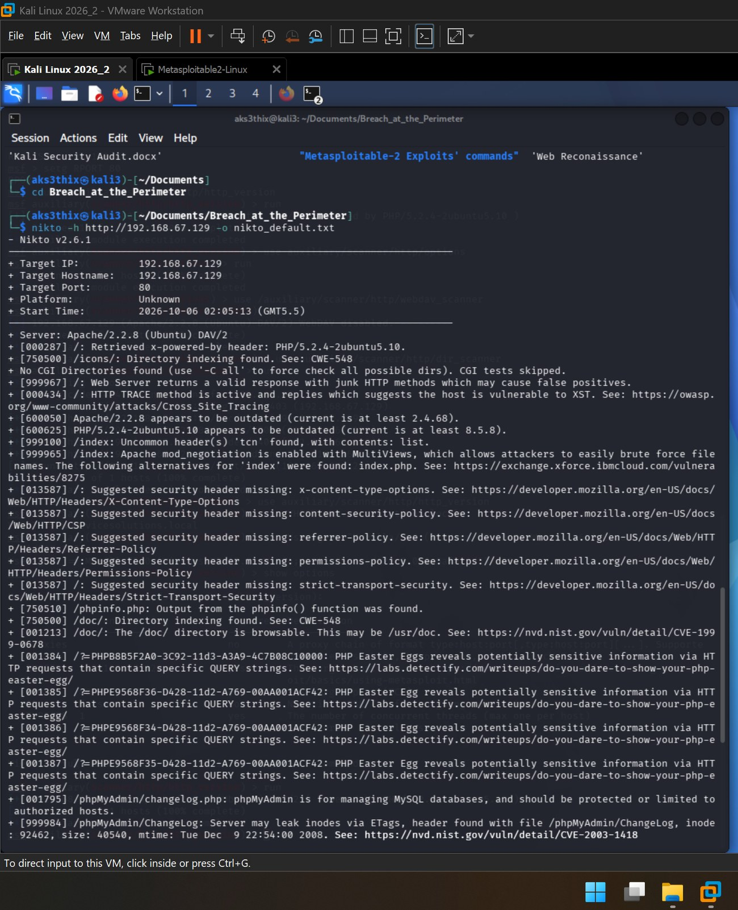
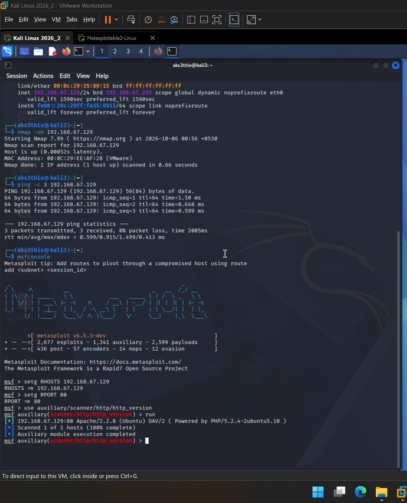
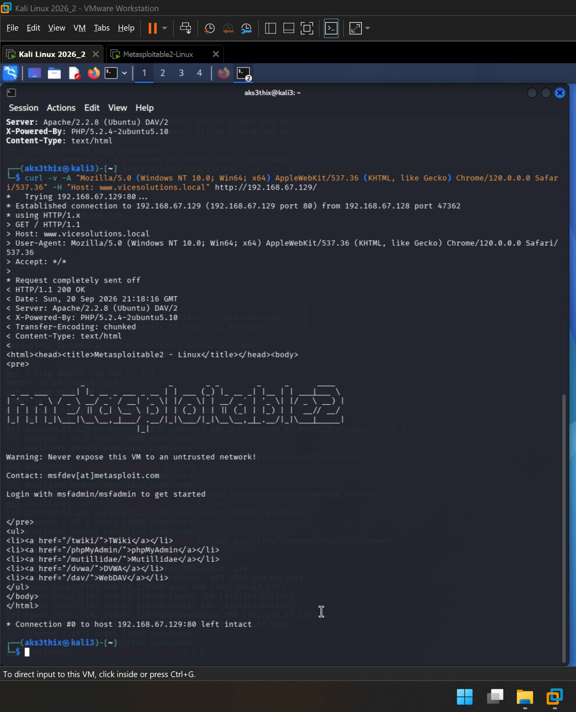

# Breach at the Perimeter

### Firewall and Proxy Evasion using Metasploit and Nikto

A hands-on web-perimeter penetration test and scanner-evasion exercise against an isolated
Metasploitable 2 lab, carried out as a course-end project for the Advanced Executive Program
in Cybersecurity (Simplilearn / IIIT-Bangalore). The work covers reconnaissance, HTTP method
and WebDAV enumeration, header / User-Agent / host spoofing, three Nikto scan modes, and an
AI-assisted analysis that turns raw scanner output into prioritised findings and fixes.

> **Scope and ethics:** every target here is a virtual machine I own, run offline on a private
> VMware NAT network with no connection to any production or public system. "ViceSolutions" is a
> training scenario, not a real organisation. Nothing in this repo was run against a system I do
> not own or lack permission to test.

---

## Lab environment

| Component | Role | Details |
|---|---|---|
| Kali Linux 2026.2 | Attacker | `192.168.67.128` - Metasploit 6.5.3, Nikto 2.6.1, curl |
| Metasploitable 2 | Target | `192.168.67.129` - Apache 2.2.8 (Ubuntu), PHP 5.2.4 |
| VMware Workstation Pro | Hypervisor | Both VMs on NAT (VMnet8), isolated from the physical LAN |

No containers were used; the tooling runs natively on Kali.

---

## Methodology

The engagement follows a reconnaissance-led flow, structured as five tasks:

1. **Setup and target resolution** - prepare Kali, confirm connectivity, positively identify the target.
2. **Reconnaissance (Metasploit)** - server banner, HTTP methods, WebDAV status, directory discovery.
3. **Evasion** - disguise requests with Host-header, virtual-host and User-Agent spoofing.
4. **Vulnerability scanning (Nikto)** - run default, spoofed and mutated (encoded) modes, then compare.
5. **AI-assisted analysis** - consolidate raw output into prioritised findings, risk ratings and countermeasures.

---

## Key findings

Nine distinct issues were confirmed, three of them High severity.

| # | Finding | Risk | Countermeasure |
|---|---------|------|----------------|
| 1 | Outdated Apache 2.2.8 (EOL) | High | Upgrade Apache; migrate off the end-of-life OS |
| 2 | Outdated PHP 5.2.4 (EOL) | High | Upgrade PHP to a supported branch |
| 3 | Exposed phpMyAdmin + ETag inode leak (CVE-2003-1418) | High | Restrict to authorised hosts/auth; `FileETag None` |
| 4 | TRACE method enabled (Cross-Site Tracing / XST) | Medium | `TraceEnable off` |
| 5 | phpinfo.php information disclosure | Medium | Remove the script; `expose_php = Off` |
| 6 | Directory indexing (`/icons/`, `/doc/`, `/test/`) | Low-Med | `Options -Indexes` |
| 7 | mod_negotiation / MultiViews (`tcn` header) | Low-Med | `Options -MultiViews` |
| 8 | Missing security headers (XCTO, CSP, Referrer-Policy, Permissions-Policy, HSTS) | Medium | Set via `mod_headers` |
| 9 | PHP Easter eggs + `/icons/README` default file | Low | `expose_php = Off`; remove default files |

The full writeup with evidence lives in [`report/`](report/).

---

## The evasion story (the point of the project)

Nikto was run three ways against the same host. On an undefended target the *results* barely
move under spoofing, but the mutated (encoded) run tells the real story:

| Mode | Items reported | What changed |
|------|----------------|--------------|
| Default | **31** | Full baseline, every check landed (8,235 requests) |
| Spoofed (fake UA + vhost) | ~31 | Same findings; only the reported host label changed |
| Mutated (`-evasion 1`, URI encoding) | **19** | Encoding changed request fingerprints, so Nikto's own signatures missed the phpMyAdmin, Easter-egg, `/doc/` and `/test/` checks |

**Takeaway:** the same obfuscation that made Nikto's signatures miss 12 findings is exactly what
defeats a signature-based IDS or WAF in production. That is the argument for request normalisation
at the perimeter.



---

## Repository structure

```
Breach-at-the-Perimeter/
├── README.md
├── report/
│   └── Breach_at_the_Perimeter_VAPT_Report.pdf    <- full report (renders in-browser on GitHub)
├── scans/
│   ├── nikto_default.txt
│   ├── nikto_spoofed.txt
│   └── nikto_mutated.txt
└── screenshots/                                   <- numbered evidence, 01 to 20
```

---

## Evidence highlights

| Recon | Evasion |
|---|---|
|  |  |
| Banner: Apache/2.2.8 (Ubuntu) DAV/2, PHP 5.2.4 | curl -v showing a forged Host and Chrome User-Agent |

---

## Skills demonstrated

- Web-layer reconnaissance and service fingerprinting (Metasploit auxiliary scanners, curl).
- HTTP method analysis and Cross-Site Tracing (XST) confirmation.
- Scanner evasion technique (header, vhost and User-Agent spoofing; Nikto `-evasion` encoding).
- Risk-based triage: collapsing raw scanner noise into rated findings mapped to concrete controls.
- Clear security reporting aligned to how a GRC analyst communicates risk and remediation to stakeholders.

---

## Reproduce (high level)

1. Run Kali and Metasploitable 2 in VMware on the same NAT network.
2. Confirm the target IP (`ifconfig` on the target; `nmap -sn` and `ping` from Kali).
3. Work through the five tasks in `report/Breach_at_the_Perimeter_VAPT_Report.pdf` (Sections 5-9), which documents every command used, the expected output, and the fix for each step that can misbehave.

---

*Course-end project. Analysis stage assisted by AI (Claude); all testing performed by me in my own lab.*
